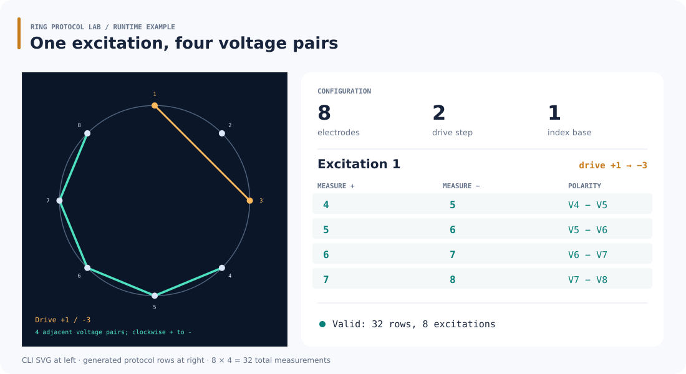

<p></p>

# Ring Protocol Lab

生成环形电极的激励与相邻电压测量表，核对通道顺序、编号和极性。输出 JSON、CSV 和 SVG，适合编写 EIT 扫描固件前检查协议。

## 运行示例

下面是 8 电极、步长 2、从 1 编号的实际输出：激励 `+1 / −3`，对应 4 组电压测量；完整协议共 32 行。



复现图中结果，需 Python 3.10+。在项目根目录运行：

```sh
python -m ring_protocol_lab generate -n 8 --drive-step 2 --index-base 1 -o protocol.json
python -m ring_protocol_lab validate -n 8 --drive-step 2 --index-base 1 protocol.json
python -m ring_protocol_lab svg -n 8 --drive-step 2 --index-base 1 --excitation 1 -o ring.svg
```

浏览器打开 `ring.svg`。橙色连线是激励对，绿色连线是可用的相邻电压测量对。图中左侧为 CLI 原始 SVG，右侧由同次生成的 JSON 绘制。

[查看协议 JSON](assets/protocol.json) · [查看原始 SVG](assets/ring-runtime.svg)

## 导出 CSV

```sh
python -m ring_protocol_lab generate -n 8 --drive-step 1 --index-base 0 --format csv -o protocol.csv
```

列顺序为 `excitation, drive_plus, drive_minus, measure_plus, measure_minus`。CSV 只包含测量表，配置随实验记录另存；JSON 则包含 `schema`、`config` 和 `rows`。

不传 `-o` 时写到标准输出。输出目录须已存在，已有同名文件会被覆盖。

## 协议规则

- 电极数 `-n` 为 4–512；`--drive-step` 为 1 到 n−1，表示顺时针距离。
- `--index-base` 必须指定 0 或 1，同时决定电极和激励编号。
- 对内部零基激励 i，电流正端为 i，负端为 `(i + step) mod n`。
- 电压正端 j、负端 `(j + 1) mod n` 都不在激励对中，才保留该测量。
- 先按激励编号、再按测量正端排序，保留环绕边和反向激励。
- 相邻激励每次得到 n−3 组测量，其余得到 n−4 组。4 电极对径激励无可用测量，会报错。
- 电压极性为 `V(measure_plus) − V(measure_minus)`。

`validate` 校验 JSON 的配置、字段、行数、顺序与极性，要求完整协议表。成功退出 `0`；参数、文件或协议错误退出 `2`。

## 开发

运行和测试均只用 Python 标准库：

```sh
python -m unittest discover -s tests -v
```

- `protocol.py`：配置、生成和校验。
- `svg.py`：环形示意图。
- `__main__.py`：命令行与文件格式。
- `examples/`：4 电极 JSON/CSV、8 电极 SVG。

协议生成与校验在内存中完成，复杂度为 O(n²)。SVG 人工检查建议使用 8–32 电极。硬件接线映射和采样时序由采集程序配置；本工具输出电极编号与测量关系。
